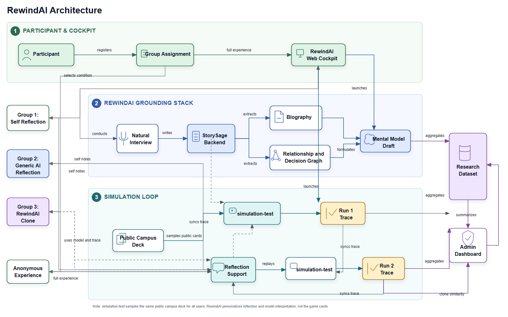

# RewindAI

**Inspectable and Revisable Autobiographical Clones for Reflective Social Decisions**

**Accepted to the UIST 2026 Poster Track.**  
Yuzhang Zhong, Min Kim, and Rangjiacheng Lu

[Project overview](https://yuzhang-zhong.github.io/portfolio/rewindai) · [Publication details](https://yuzhang-zhong.github.io/publication/2026-rewindai) · [System overview](#system-overview) · [Local development](#local-development)

RewindAI is a research prototype that helps people inspect and revise how an AI
clone represents their social decisions. A natural-language interview becomes
an editable biography, a relationship/decision graph, and a plain-language
mental model. A campus decision simulation then gives users a concrete setting
for reflecting on choices and exploring a different path.

### What you can explore

- **Inspect personal grounding:** review the experiences, relationships, values,
  and trade-offs behind a generated model.
- **Revise the representation:** edit biography content and revisit model
  hypotheses rather than treating the clone as a fixed portrait.
- **Reflect and replay:** examine a simulation trace with self-reflection,
  generic AI, or clone-style support, then compare a second run.

The research question is whether autobiographical grounding can help people
understand their decisions and reflect on alternatives. Generated models are
hypotheses for reflection, not authoritative judgments about a person.

This public code snapshot was originally prepared for anonymous review. It
excludes real API keys, database passwords, local machine paths, hosting-owner
URLs, `.env` files, logs, local databases, and credential files. No hosted demo
or provider credentials are bundled. See the [release limitation](#release-limitation)
before attempting the full local experience.

## System Overview



*System architecture: interview evidence connects the biography and decision
graph to the simulation and reflection loop.*

RewindAI has three core applications and one optional service:

| Module | Purpose |
| --- | --- |
| [`StorySage/`](StorySage/readme.md) | Backend for interviews, biographies, graph/model generation, reflection, trace ingestion, admin summaries, and persistence. |
| [`StorySage_Frontend/`](StorySage_Frontend/README.md) | Main RewindAI web cockpit and admin dashboard. |
| [`Rewind-reigns/`](Rewind-reigns/README.md) | `simulation-test`, a campus decision game that records behavioral traces. |
| [`rewindai-mirofish-backend/`](rewindai-mirofish-backend/README.md) | Optional backend-only graph compatibility service. |

The intended flow is:

1. A user tells natural autobiographical stories.
2. StorySage turns those stories into a biography, graph, and mental-model draft.
3. The user plays a shared campus decision simulation.
4. The simulation trace returns to StorySage.
5. The user reflects alone, with generic AI, or with a clone-style assistant.
6. The user replays the simulation and the system summarizes changes.

## Research Conditions

These modes describe the implemented study flows, not reported study outcomes.

| Mode | Flow |
| --- | --- |
| `blank` / Group 1 | First simulation run -> self-reflection -> second simulation run. |
| `contrast` / Group 2 | First simulation run -> generic AI reflection using only the game report -> second simulation run. |
| `experiment` / Group 3 | Interview -> biography/graph/model -> first simulation run -> clone reflection -> second simulation run. |
| `anonymous` | Open product experience without research step labels. |

## Agents and Evidence

The backend separates the work across lightweight agents:

- **Interviewer** conducts natural conversation and asks focused probes about
  turning points, trade-offs, uncertainty, and relationship pressure.
- **Session Scribe** stores privacy-safe session memory.
- **Session Coordinator / Planner** keeps the interview focused on a few
  meaningful topics rather than a long questionnaire.
- **Biography Writer** creates an editable autobiography with decision-logic
  analysis.
- **Graph Builder** extracts relationship roles, decision episodes, values,
  trade-offs, uncertainty, and decision rules.
- **Mental Model Formulator** summarizes evidence-grounded hypotheses for
  reflection.

Interview/biography evidence is treated as autobiographical grounding.
Simulation traces are treated as tentative behavioral signals, not as ground truth
about a person's motivations.

## Privacy Boundary

Do not commit:

- model provider keys;
- database URLs with passwords;
- admin or service-role tokens;
- `.env` files;
- local databases or logs;
- credential JSON/PEM/key files;
- local absolute paths;
- hosting project IDs or owner-specific deployment URLs.

Configure real values through untracked local environment files or the hosting
platform environment-variable UI.

For local development, put backend values in an untracked `StorySage/.env`
file. Replace the placeholders with your own values:

```env
MODEL_NAME=gpt-4o
OPENAI_API_KEY=<your-model-provider-key>
DATABASE_URL=sqlite:///./data/interview_app.db
DATA_DIR=data
LOGS_DIR=logs
STORYSAGE_JWT_SECRET=<your-long-random-secret>
REWINDAI_ADMIN_TOKEN=<your-admin-token>
PUBLIC_FRONTEND_URL=http://127.0.0.1:5173
MIROFISH_GRAPH_SYNC_ENABLED=false
```

For the main frontend, use `StorySage_Frontend/.env.local`:

```env
VITE_API_BASE_URL=http://127.0.0.1:8000
VITE_REWIND_APP_URL=http://127.0.0.1:5174
```

The optional graph service is not needed for the basic configuration above. If
you enable graph synchronization, configure `MIROFISH_BASE_URL` with the backend
service you operate. Model-backed features require provider credentials and may
incur API usage charges.

Never expose provider keys through frontend `VITE_*` variables.

## Local Development

### Release limitation

The current snapshot imports `utils.llm.gcp_credentials` from the provider
status and Vertex-model modules, but does not include
`StorySage/src/utils/llm/gcp_credentials.py`. The backend's server import path
therefore needs that helper restored before the full application can start.
The commands below document the intended setup; this is not yet a verified
clean-checkout, end-to-end demo.

### Prerequisites

- Python 3.12, matching the backend's Docker runtime.
- Node.js 22.12 or newer and npm, compatible with the frontend's locked Vite version.
- Your own model-provider credentials, configured on the backend only.

Clone the public repository:

```bash
git clone https://github.com/yuzhang-zhong/rewindai-anonymous-release.git
cd rewindai-anonymous-release
```

After resolving the release limitation, configure the local environment files
above and start the following services in separate terminals. Run each command
block from the repository root.

Start the backend:

```powershell
cd StorySage
pip install -r requirements.txt
python src/main.py --mode setup_db
python src/main.py --mode server --port 8000
```

Start the main frontend:

```powershell
cd StorySage_Frontend
npm install
npm run dev
```

Start simulation-test:

```powershell
cd Rewind-reigns
npm install
npm run dev
```

Default local URLs:

- RewindAI cockpit: `http://127.0.0.1:5173`
- StorySage API: `http://127.0.0.1:8000`
- simulation-test: `http://127.0.0.1:5174`

## Verification

The repository includes the following smoke checks. These are commands to run,
not a claim that they currently pass on a fresh checkout:

```powershell
cd StorySage
python scripts/smoke_rewindai_backend.py
```

```powershell
cd StorySage_Frontend
npm run build
npm run smoke:rewindai-ui
```

```powershell
cd Rewind-reigns
npm run smoke:session
npm run smoke:bridge
```

## More Documentation

- [Backend](StorySage/readme.md)
- [Web cockpit](StorySage_Frontend/README.md)
- [Campus simulation](Rewind-reigns/README.md)
- [Optional graph service](rewindai-mirofish-backend/README.md)
- [Deployment notes](deploy/README.md)
- [Architecture figures](images/README.md)

## Acknowledgments

RewindAI builds on [StorySage](https://github.com/ShayanTalaei/StorySage)
and [StorySage Frontend](https://github.com/Hello-Imagine/StorySage_Frontend).
We thank their authors and contributors for the interview, biography, and
interface foundations.
