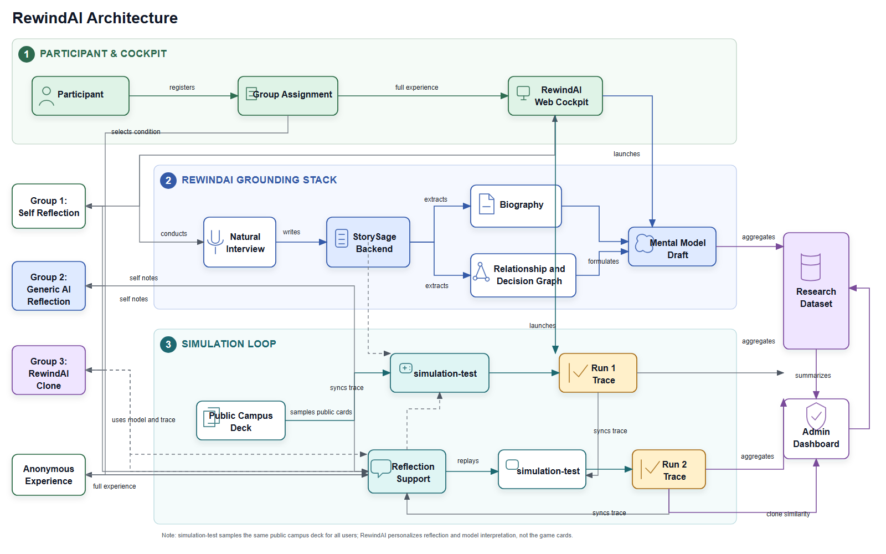

<div align="center">

# RewindAI

**Inspectable and Revisable Autobiographical Clones for Reflective Social Decisions**

[English](README.md) · **简体中文**

[](StorySage/)
[](StorySage_Frontend/package.json)
[](#release-limitation)

**已被 UIST 2026 Poster Track 接收。**  
Yuzhang Zhong、Min Kim、Rangjiacheng Lu

[项目介绍](https://yuzhang-zhong.github.io/portfolio/rewindai) · [论文信息](https://yuzhang-zhong.github.io/publication/2026-rewindai) · [系统概览](#system-overview) · [本地开发](#local-development) · [隐私边界](#privacy-boundary) · [文档](#more-documentation)

</div>

RewindAI 是一个研究原型，帮助人们检查、修改 AI 分身对自身社会决策的表征。自然语言访谈会形成可编辑传记、关系 / 决策图和易读的心智模型。校园决策模拟提供具体情境，让用户反思选择并尝试不同路径。

<a id="what-you-can-explore"></a>
## 可以探索什么

- 检查个人依据：查看生成模型背后的经历、关系、价值观与取舍。
- 修改表征：编辑传记内容，重新考虑模型假设，不把分身视为固定的人格画像。
- 反思与重玩：独立反思、使用通用 AI，或使用分身式支持查看模拟轨迹，再比较第二次运行。

研究关注自传式依据能否帮助人们理解决策、反思替代选择。生成模型是供反思的假设，不是对一个人的权威判断。

这个公开代码快照最初为匿名评审准备，不包含真实 API key、数据库密码、本机路径、托管账户 URL、`.env` 文件、日志、本地数据库或凭据文件。仓库不提供托管演示或提供商凭据。尝试完整本地体验前，请先读[发布限制](#release-limitation)。

> [!IMPORTANT]
> **这是研究快照，不是开箱即用的托管发布版。** 后端缺少凭据辅助模块，需要先恢复才能启动。请在搭建前阅读[发布限制](#release-limitation)；生成的个人模型仍是用于反思的假设。

<a id="system-overview"></a>
## 系统概览



*访谈证据将传记、决策图连接到模拟和反思循环。*

系统包含三个主要应用和一个可选服务：

| 模块 | 职责 |
| --- | --- |
| [`StorySage/`](StorySage/readme.md) | 访谈、传记、图 / 模型生成、反思、轨迹接收、管理摘要与持久化后端 |
| [`StorySage_Frontend/`](StorySage_Frontend/README.md) | 主要 RewindAI 网页驾驶舱与管理面板 |
| [`Rewind-reigns/`](Rewind-reigns/README.md) | 记录行为轨迹的校园决策游戏 `simulation-test` |
| [`rewindai-mirofish-backend/`](rewindai-mirofish-backend/README.md) | 可选的纯后端图兼容服务 |

设计中的流程：

1. 用户讲述自然的自传式故事。
2. StorySage 将故事整理为传记、图和心智模型草稿。
3. 用户运行共享的校园决策模拟。
4. 模拟轨迹回传给 StorySage。
5. 用户独立反思，或接受通用 AI / 分身式助手的支持。
6. 用户重新运行模拟，系统汇总变化。

<a id="research-conditions"></a>
## 研究条件

下表描述已经实现的研究流程，不代表已报告的研究结果。

| 模式 | 流程 |
| --- | --- |
| `blank` / Group 1 | 第一次模拟 → 独立反思 → 第二次模拟 |
| `contrast` / Group 2 | 第一次模拟 → 仅根据游戏报告进行通用 AI 反思 → 第二次模拟 |
| `experiment` / Group 3 | 访谈 → 传记 / 图 / 模型 → 第一次模拟 → 分身反思 → 第二次模拟 |
| `anonymous` | 不显示研究步骤标签的开放产品体验 |

<a id="agents-and-evidence"></a>
## Agent 与证据

后端将工作拆分给不同的轻量 Agent：

- **Interviewer**：自然访谈，围绕转折、取舍、不确定性与关系压力追问。
- **Session Scribe**：保存经过隐私处理的会话记忆。
- **Session Coordinator / Planner**：让访谈聚焦于少数有意义的主题，避免变成长问卷。
- **Biography Writer**：生成可编辑自传和决策逻辑分析。
- **Graph Builder**：提取关系角色、决策片段、价值观、取舍、不确定性与决策规则。
- **Mental Model Formulator**：汇总有证据依据、用于反思的假设。

访谈和传记证据作为自传式依据。模拟轨迹只作为暂时性的行为信号，不能直接当作个人动机的真实答案。

<a id="privacy-boundary"></a>
## 隐私边界

不要提交：

- 模型提供商 key；
- 包含密码的数据库 URL；
- 管理员或 service-role token；
- `.env` 文件；
- 本地数据库或日志；
- 凭据 JSON / PEM / key 文件；
- 本机绝对路径；
- 托管项目 ID 或与账户绑定的部署 URL。

真实值应通过不跟踪的本地环境文件，或托管平台的环境变量界面配置。

本地开发时，把后端配置写入不跟踪的 `StorySage/.env`，将占位符替换为自己的值：

```env
MODEL_NAME=gpt-4o
OPENAI_API_KEY=<your-model-provider-key>
DATABASE_URL=sqlite:///./data/interview_app.db
DATA_DIR=data
LOGS_DIR=logs
STORYSAGE_JWT_SECRET=<your-long-random-secret>
REWINDAI_ADMIN_TOKEN=<your-admin-token>
PUBLIC_FRONTEND_URL=http://127.0.0.1:5173
MIROFISH_GRAPH_SYNC_ENABLED=false
```

主前端使用 `StorySage_Frontend/.env.local`：

```env
VITE_API_BASE_URL=http://127.0.0.1:8000
VITE_REWIND_APP_URL=http://127.0.0.1:5174
```

上面的基本配置不需要可选图服务。启用图同步时，应将 `MIROFISH_BASE_URL` 指向自己运营的后端服务。模型功能需要提供商凭据，且可能产生 API 费用。

不要通过前端 `VITE_*` 变量暴露模型提供商 key。

<a id="local-development"></a>
## 本地开发

<a id="release-limitation"></a>
### 发布限制

当前快照的提供商状态模块和 Vertex 模型模块会导入 `utils.llm.gcp_credentials`，但仓库缺少 `StorySage/src/utils/llm/gcp_credentials.py`。后端的服务导入路径需要先恢复这个辅助模块，完整应用才能启动。

下方命令记录预期的搭建方式，**不代表已经验证了从干净克隆到完整运行的端到端演示**。

<a id="prerequisites"></a>
### 环境要求

- Python 3.12，与后端 Docker 运行环境一致。
- Node.js 22.12 或更新版本，以及 npm，以兼容前端锁定的 Vite 版本。
- 自己的模型提供商凭据，仅配置在后端。

克隆公开仓库：

```bash
git clone https://github.com/yuzhang-zhong/rewindai-anonymous-release.git
cd rewindai-anonymous-release
```

先解决上述发布限制，再配置本地环境文件。在不同终端启动各服务；每段命令都从仓库根目录开始。

后端：

```powershell
cd StorySage
pip install -r requirements.txt
python src/main.py --mode setup_db
python src/main.py --mode server --port 8000
```

主前端：

```powershell
cd StorySage_Frontend
npm install
npm run dev
```

simulation-test：

```powershell
cd Rewind-reigns
npm install
npm run dev
```

默认本地地址：

- RewindAI 驾驶舱：`http://127.0.0.1:5173`
- StorySage API：`http://127.0.0.1:8000`
- simulation-test：`http://127.0.0.1:5174`

<a id="verification"></a>
## 检查命令

仓库包含以下冒烟检查。它们是供运行的命令，不代表当前在全新克隆下全部通过：

```powershell
cd StorySage
python scripts/smoke_rewindai_backend.py
```

```powershell
cd StorySage_Frontend
npm run build
npm run smoke:rewindai-ui
```

```powershell
cd Rewind-reigns
npm run smoke:session
npm run smoke:bridge
```

<a id="more-documentation"></a>
## 更多文档

- [后端](StorySage/readme.md)
- [网页驾驶舱](StorySage_Frontend/README.md)
- [校园模拟](Rewind-reigns/README.md)
- [可选图服务](rewindai-mirofish-backend/README.md)
- [部署说明](deploy/README.md)
- [架构图](images/README.md)

<a id="acknowledgments"></a>
## 致谢

RewindAI 基于 [StorySage](https://github.com/ShayanTalaei/StorySage) 与 [StorySage Frontend](https://github.com/Hello-Imagine/StorySage_Frontend) 构建，感谢原作者与贡献者提供的访谈、传记及界面基础。
