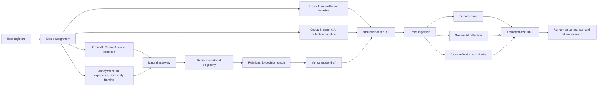

# RewindAI Project Technical Documentation

Last updated: 2026-06-25

This document summarizes the current RewindAI research prototype from the perspective of system innovation, agent architecture, graph/mental-model design, and experimental design. It intentionally does not emphasize frontend/backend implementation details except where they are necessary for understanding the research mechanism.

## 1. One-Sentence Definition

RewindAI is a natural-language grounded decision-reflection system that builds a tentative user-specific decision model from autobiographical interview evidence, relationship/decision graph memory, and simulation-test traces, then uses that model to support counterfactual reflection before a second decision-simulation run.

The core design principle is:

> Do not personalize the game cards. Personalize the reflection, interpretation, and clone-assisted reasoning after the first run.

This distinction is important. The simulation-test deck remains public and comparable across users. The user's grounded model is used after behavior is observed, not to create a different game for each person.

## 2. Research Motivation

Many LLM-based agents can imitate conversational style, answer survey questions, or provide generic advice, but they often lack a grounded representation of how a specific person weighs choices under social pressure, uncertainty, scarce resources, and conflicting values.

RewindAI addresses this gap by asking:

1. Can a short natural autobiographical interview produce a usable decision-centered profile without turning the interaction into a questionnaire?
2. Can relationship and decision-logic graphs make the user's mental model more interpretable than a plain biography summary?
3. Can a clone-like reflection agent help users notice plausible unchosen paths after a first simulation run?
4. Can the effect of clone-grounded reflection be compared against self-reflection and generic AI reflection without changing the simulation task itself?

The project is therefore not only a game and not only a chatbot. It is a research system for studying how personal grounding, graph memory, and reflective agent support may influence decision-making in repeated simulated scenarios.

## 3. Core Innovation

### 3.1 Natural Interview Instead of Questionnaire-First Modeling

The system avoids asking the user to fill out structured personality or preference inventories first. Instead, it uses natural dialogue to elicit concrete moments:

- turning points;
- high-stakes or high-tradeoff situations;
- relationship pressure;
- missing information;
- protected values;
- decision boundaries;
- "if I could go back" counterfactual variables.

This is inspired by critical incident style interviewing and laddering-style probing, but it is implemented as conversational guidance rather than a formal survey.

### 3.2 Session Coordinator as the Planner

The system does not expect the Interviewer Agent alone to discover the overall structure. The Session Coordinator is the planning layer. Its job is to keep the interview focused around a small number of meaningful topics while preserving a natural conversational feel.

Current intended behavior:

- guide the session toward about three typical topics or scenes;
- keep the experience around a 20-turn interview budget for Group 3 and anonymous full-experience users;
- decide when it is useful to ask for a concrete scene;
- avoid forcing the user into a rigid "scenario form";
- mark when there is enough evidence to generate biography, graph, and mental model.

The distinction is important:

- The Interviewer asks the next humane question.
- The Session Coordinator manages the session-level evidence plan.

### 3.3 Decision-Centered Biography

The generated biography is not only a life-story summary. It must contain a dedicated `Decision Logic Analysis` / `决策逻辑分析` section.

This section summarizes:

- recurring trade-offs;
- values the user appears to protect;
- relationship pressures;
- information gaps;
- decision boundaries;
- counterfactual variables;
- early hypotheses about how choices may shift under different conditions.

The writing rule is conservative: use "early signal", "hypothesis", or "draft" language when evidence is incomplete. The system should not diagnose the user or make unsupported personality claims.

### 3.4 Relationship-Decision Graph Memory

RewindAI converts biography/interview evidence into a graph-like memory. The graph is not a decorative mind map. It is a typed representation of the user's decision context.

Important node families:

| Node type | Meaning |
| --- | --- |
| `self` | The current user as the center of the graph. |
| `person_or_role` | People, roles, groups, or institutions mentioned by the user. |
| `decision_episode` | Concrete choice moments or turning points. |
| `relationship_pressure` | Obligations, expectations, role pressure, or social tension. |
| `value_or_goal` | Values, goals, principles, or needs the user may be protecting. |
| `tradeoff` | Conflicting goals, approach-avoidance tensions, or resource conflicts. |
| `uncertainty` | Missing information, ambiguity, or decision-changing variables. |
| `decision_rule` | Tentative if-then rules or coping heuristics. |
| `simulation_signal` | Behavioral trace signals from simulation-test, always tentative. |

Important edge families:

| Edge type | Intended interpretation |
| --- | --- |
| `autobiographical_context` | A relation comes from the user's story context. |
| `situational_cue` | A concrete event triggers a choice or emotional response. |
| `role_expectation` | A relationship role carries expectations or obligations. |
| `emotional_activation` | A pressure cue may change attention, urgency, or affect. |
| `value_protection` | A choice may protect a value, goal, or relationship. |
| `motivational_conflict` | Two motives pull against each other. |
| `value_conflict` | One value may be protected while another is risked. |
| `decision_boundary` | Uncertainty or missing information shifts the choice threshold. |
| `coping_heuristic` | A tentative rule for handling similar decisions. |
| `counterfactual_anchor` | A "what-if" variable that helps locate the decision boundary. |
| `behavioral_hypothesis` | A tentative signal derived from game traces, not biography fact. |

The graph has bilingual labels in the current design. It should support Chinese and English viewing so that users can understand their own graph in the language they used during the interview.

### 3.5 Evidence Boundary as a First-Class Design Feature

RewindAI separates evidence sources:

| Evidence source | Status | How it should be used |
| --- | --- | --- |
| Interview messages | autobiographical or provisional grounding | Can support biography and graph hypotheses. |
| Biography draft | confirmed or editable autobiographical grounding | Stronger source for graph and mental model. |
| Graph memory | interpreted relationship/decision structure | Useful for formulation and reflection, but still a model. |
| simulation-test traces | tentative behavioral evidence | Useful for reflection and mismatch analysis, not user identity. |
| Clone replay | tentative same-question choice agreement | A reflective signal, not proof that the clone is accurate. |

This evidence boundary prevents a major conceptual error: game behavior should not silently rewrite the user's biography or identity. Instead, traces can suggest questions, hypotheses, and reflection targets.

### 3.6 Same-Question Clone Similarity

For the experiment group, after the first simulation-test run, the clone evaluates the exact same cards that the user saw. It does not generate a personalized deck and does not answer a different task.

The current clone similarity concept:

- collect the user's first-run cards and choices;
- ask the clone, grounded in the user's mental model, whether it would repeat or question each recorded choice;
- compute agreement as `matched choices / total replayed questions`;
- summarize mismatch categories by card domain, decision type, risk level, target meter, and failure mode;
- use mismatches as reflection targets before the second run.

Current limitation:

- The trace contains the user's chosen option and card context, not always every original option. Therefore the similarity score is a same-choice endorsement measure, not a complete four-option prediction measure.

This score should be treated as tentative and interpretive. It is not a claim that the system perfectly cloned the person.

## 4. Conceptual System Flow

## 5. Project Module Map

The current workspace contains several projects, but the research logic lives mainly in three modules.

| Module | Role in RewindAI |
| --- | --- |
| `StorySage` | Main backend for interview, biography, graph state, mental model, traces, clone reflection, admin analysis. |
| `StorySage_Frontend` | Main user cockpit and research flow UI. |
| `Rewind-reigns` | `simulation-test`, the campus decision simulation module. |
| `MiroFish` / `rewindai-mirofish-backend` | Optional backend graph construction service. If unavailable, StorySage builds a local relationship-decision graph draft. |
| `images` | Research figures and architecture diagrams for poster/paper use. |
| `figure-studio-runs` | Figure-generation prompt packages and checkpoint outputs. |

Key implementation files:

| File | Why it matters |
| --- | --- |
| `StorySage/src/api/routers/chat.py` | Interview message flow. |
| `StorySage/src/agents/interviewer/interviewer.py` | Interviewer Agent logic. |
| `StorySage/src/agents/biography_team/session_coordinator/session_coordinator.py` | Session-level planning and agenda logic. |
| `StorySage/src/api/services/fast_biography.py` | Fast biography generation and decision logic section. |
| `StorySage/src/api/services/biography_rewrite.py` | Shorter, longer, more specific rewrite preview/apply flow. |
| `StorySage/src/api/services/mirofish_graph_sync.py` | Graph rebuild, fallback graph, evidence manifest. |
| `StorySage/src/api/services/mental_model.py` | Mental model formulation and stale-state handling. |
| `StorySage/src/api/services/simulation_traces.py` | Trace persistence and summary. |
| `StorySage/src/api/services/trace_analysis.py` | Behavioral trace metrics and reflection state analysis. |
| `StorySage/src/api/services/clone_similarity.py` | Same-card clone replay and similarity score. |
| `StorySage/src/api/routers/simulation_profile.py` | Simulation handoff, general reflection, clone reflection chat. |
| `StorySage/src/api/routers/admin.py` | Admin data aggregation and deletion controls. |
| `Rewind-reigns/server/game-data.mjs` | Public campus decision deck generation. |
| `Rewind-reigns/src/App.tsx` | Simulation-test user flow, records, clone panel, bilingual UI. |

## 6. Agent Architecture

### 6.1 Session Coordinator Agent

Role: session-level planner.

Main responsibility:

- select a compact set of topics or scenes;
- keep the interview natural rather than questionnaire-like;
- decide when enough grounding evidence exists;
- coordinate the transition from interview to biography and model building.

Inputs:

- current session messages;
- previous interview state;
- biography availability;
- graph/formulation status;
- optionally tentative trace summaries after simulation-test.

Outputs:

- next agenda or topic direction;
- readiness signal for biography generation;
- high-level progress status.

Design logic:

- The user should feel they are telling stories, not filling fields.
- The system may suggest a scene only when the conversation benefits from concrete grounding.
- Three meaningful topics are usually better than a broad but shallow life history.

### 6.2 Interviewer Agent

Role: humane conversational elicitation.

Main responsibility:

- ask one clear question at a time;
- mirror and validate the user's emotional/decision context;
- use laddering probes to extract values and decision boundaries;
- avoid excessive follow-up loops or robotic interrogation.

Typical probes:

- "What was hardest to give up in that moment?"
- "What information did you wish you had?"
- "If you could replay that moment, what variable would change your choice?"
- "Who else was affected by that decision?"
- "Was this more about protecting something, avoiding something, or proving something?"

Design boundary:

- The Interviewer should not independently decide the whole session structure. That belongs to the Session Coordinator.

### 6.3 Session Scribe / Memory Extraction Agent

Role: convert conversation into useful evidence.

Main responsibility:

- extract direct facts without over-interpreting them;
- identify relationship roles and decision episodes;
- tag privacy-sensitive content;
- preserve evidence boundaries;
- support biography and graph generation.

What it should capture:

- people/roles;
- places generalized when needed;
- conflict or support relationships;
- decision moments;
- emotional pressure;
- missing information;
- user corrections;
- tentative values and goals.

What it should not do:

- diagnose personality;
- expose raw sensitive details in admin summaries;
- treat a single game choice as a stable trait.

### 6.4 Biography Writer Agent

Role: synthesize interview evidence into a readable decision-centered profile.

Main responsibility:

- write a coherent autobiographical profile;
- include a dedicated decision logic analysis;
- preserve groundedness;
- avoid unsupported claims;
- support later graph construction.

Required biography structure:

| Section type | Purpose |
| --- | --- |
| Overview | Short reflective summary of the user's story evidence. |
| Key lived scenes | Concrete moments or topics from the interview. |
| Relationships and trade-offs | Social and contextual pressures around decisions. |
| Decision Logic Analysis | The core RewindAI innovation: trade-offs, values, boundaries, uncertainty, counterfactual variables. |
| Questions to carry forward | Suggestions for future interviews or reflection. |

Rewrite actions:

- `shorter`: compress while preserving decision evidence;
- `longer`: expand supported detail;
- `more_specific`: move from abstract summary to concrete scenes and variables.

Important implementation detail:

- Rewrite is preview-before-apply. The user can cancel without overwriting the current biography.

### 6.5 Graph Builder Agent / Graph Memory Layer

Role: convert biography and trace evidence into a typed relationship-decision graph.

Graph sources:

- privacy-safe biography text;
- provisional interview grounding if biography is incomplete;
- compact simulation trace summary as tentative evidence;
- evidence manifest with source status.

Graph outputs:

- typed nodes and edges;
- bilingual labels;
- evidence status;
- source manifest;
- graph state with progress and fallback status.

Graph generation paths:

| Path | Behavior |
| --- | --- |
| MiroFish backend available | StorySage submits source payload to MiroFish graph APIs and stores returned graph. |
| MiroFish unavailable or serverless background blocked | StorySage builds a local relationship-decision graph draft. |

The local fallback is now intentionally meaningful. It should not create vague nodes like "Decision trade-offs" only. It extracts roles, episodes, pressure, values, trade-offs, uncertainty, rules, and tentative simulation signals.

### 6.6 Mental Model Formulation Agent

Role: synthesize biography, graph, and trace evidence into a decision-support formulation.

Current implementation:

- deterministic synthesis;
- no external LLM required for the basic formulation;
- stores status, confidence, evidence, gaps, relationship focus, pressure points, and decision-policy hypotheses;
- marks itself stale when biography, graph, or traces change.

Mental model fields:

| Field | Purpose |
| --- | --- |
| `grounding_summary` | Short privacy-safe grounding summary. |
| `relationship_focus` | Key graph-derived roles or relationship labels. |
| `decision_policy_hypotheses` | Tentative behavior/decision hypotheses. |
| `likely_pressure_points` | Situations likely to create decision conflict. |
| `simulation_guidance` | How to use the model safely in scenarios. |
| `privacy_boundary` | Explicit warning against diagnosis or over-claiming. |

Interpretation:

- The mental model is a reflective draft, not a clinical model.
- It is meant to guide reflection and simulation, not to classify the user.

### 6.7 Generic Reflection Agent for Group 2

Role: contrast condition.

Main responsibility:

- provide useful AI reflection using only the game report;
- not use biography, graph, mental model, or private history;
- support multi-turn conversation;
- keep the boundary clear.

This group helps test whether RewindAI's personalized grounding adds value beyond generic AI reflection.

### 6.8 Clone Reflection Agent for Group 3

Role: grounded reflective clone.

Main responsibility:

- use the mental model and first-run trace to discuss the user's choices;
- explicitly reference the mental model when useful;
- analyze unchosen paths and long-term consequences;
- avoid presenting itself as an answer key;
- keep answers concise and practical;
- avoid ending every response with a follow-up question.

Preferred response pattern:

> Because your mental model suggests X, this card may have activated Y. If you choose differently next time, the likely trade-off is Z. A useful second-run experiment is to test rule R.

Design boundary:

- The clone is not a perfect copy of the person.
- It is a tentative decision-pattern model grounded in current evidence.
- It should help the user reflect, not decide for the user.

### 6.9 Clone Similarity Evaluator

Role: quantify tentative alignment between clone and human choices.

Main responsibility:

- replay the user's first-run card contexts;
- estimate whether the clone would repeat or question each human choice;
- compute similarity percentage;
- identify mismatch categories.

Outputs:

- total replayed questions;
- matched choices;
- similarity percentage;
- per-card rationale;
- mismatch categories by domain, decision type, risk level, target meter, failure mode.

Current limitation:

- It is a same-choice endorsement score, not full original-option prediction.

### 6.10 Admin/Data Collection Agent

Role: research operations and analysis support.

Main responsibility:

- aggregate participants by group and stage;
- summarize interview message counts and simulation runs;
- summarize trace metrics without exposing raw interview text by default;
- show clone similarity, reflection coverage, high-risk rates, failure categories, and feedback counts;
- support deletion of test users, individual traces, and all participants.

The admin view is for study monitoring, not for reading private biographies.

## 7. Graph and Mental Model Framework

The graph and mental model are separate but connected.

| Layer | Input | Output | Purpose |
| --- | --- | --- | --- |
| Biography | interview transcript | narrative profile | Preserve lived experience and decision logic. |
| Graph Memory | biography + trace summary | typed nodes/edges | Make relationships, values, conflicts, and rules inspectable. |
| Mental Model | biography + graph + traces | formulation draft | Summarize likely pressure points and decision hypotheses. |
| Clone Reflection | mental model + first-run trace | dialogue and replay analysis | Help user examine unchosen paths before run 2. |

### 7.1 Why Use a Graph?

Plain biographies are good for narrative but weak for structured retrieval. A graph helps the system answer:

- Who or what roles appear in the user's decision context?
- Which values are repeatedly protected or risked?
- What kinds of trade-offs recur?
- Which uncertainties change the choice boundary?
- Which simulation signals are confirmed versus tentative?

The graph is therefore a bridge between natural language memory and structured decision reflection.

### 7.2 Psychology-Informed Relation Vocabulary

The graph relation labels are not meant to be clinical diagnoses. They are lightweight psychological constructs useful for reflective reasoning.

Examples:

- `role expectation`: a relationship role creates perceived obligation or expected behavior.
- `motivational conflict`: two motives compete, such as belonging versus autonomy.
- `value conflict`: one value is protected while another is risked.
- `decision boundary`: missing information or uncertainty shifts the threshold for choosing differently.
- `coping heuristic`: a tentative rule the user can test in a second run.
- `counterfactual anchor`: a "what would have changed my choice?" variable.

This vocabulary makes the graph more meaningful than generic edges like "related_to".

## 8. simulation-test Design

`simulation-test` is the controlled campus decision simulation environment.

### 8.1 Why a Public Deck?

The game should not become personalized per user because that would make experimental comparison difficult. Instead:

- every user draws from the same public random campus deck;
- cards are bilingual;
- the deck contains many campus situations across domains;
- runs are comparable across groups;
- personalization happens in reflection after the first run.

This design makes Group 1, Group 2, and Group 3 comparable.

### 8.2 Current Gameplay Model

Core resources:

| Meter | User-facing meaning |
| --- | --- |
| GPA | Academic performance. |
| Friends | Social relationships. |
| Energy | Mental/physical capacity. |
| Budget | Money/resources. |

Core trace fields:

- card id;
- card domain;
- prompt and speaker;
- choice direction;
- option text;
- effects on meters;
- risk level;
- target meter;
- failure modes;
- response timing;
- run number;
- final state.

### 8.3 First Run, Reflection, Second Run

The research flow uses repeated play:

1. User plays a first run.
2. The system records the full trajectory.
3. The user reflects, depending on group condition.
4. The user plays a second run.
5. The system compares traces and summarizes changes.

For Group 3, the clone can replay the same first-run cards and compute similarity before the second run.

## 9. Experimental Design

The study is an ablation-style comparison across reflection conditions.

### 9.1 Conditions

| Condition | Product label | Core experience | What it isolates |
| --- | --- | --- | --- |
| Group 1 | Blank / self-reflection | Play, self-reflect, replay | Baseline without AI reflection. |
| Group 2 | Contrast / generic AI | Play, generic AI reflection, replay | Benefit of non-personalized AI reflection. |
| Group 3 | Experiment / RewindAI clone | Interview, graph/model, play, clone reflection, replay | Added value of grounded clone reflection. |
| Anonymous | Full demo without study framing | Full RewindAI experience without experimental numbering | Public demo and qualitative feedback, not primary analysis. |

### 9.2 Group 1: Blank Baseline

User flow:

1. Start simulation-test.
2. Finish first run.
3. Write or think through self-reflection.
4. Replay.

Research purpose:

- Establish how much change occurs from repetition and self-reflection alone.

Data boundary:

- Record game traces and minimal reflection state if needed.
- Avoid treating private free-text self notes as required analysis data unless the study protocol explicitly requests it.

### 9.3 Group 2: Generic AI Reflection Baseline

User flow:

1. Start simulation-test.
2. Finish first run.
3. Open generic AI reflection chat.
4. Chat about the run using only game trace/report.
5. Replay.

Research purpose:

- Test whether any AI reflection helps compared with self-reflection.
- Keep this condition free from biography, graph, mental model, and clone context.

Data boundary:

- Reflection turns can be counted and categorized.
- The agent must not infer private history or use personalized context.

### 9.4 Group 3: RewindAI Clone Condition

User flow:

1. Conduct natural interview.
2. Generate biography, graph, and mental model.
3. Start simulation-test first run.
4. Return to RewindAI cockpit for clone reflection.
5. Clone replays same first-run cards and reports similarity.
6. User discusses key mismatches or unchosen paths with the clone.
7. User plays second run.

Research purpose:

- Test whether grounded clone reflection produces more useful second-run strategies than generic reflection.
- Examine whether graph/model-grounded explanations make clone mismatches interpretable.

Data boundary:

- Clone similarity and mismatch categories are analysis signals.
- Clone outputs are reflective artifacts, not proof of real-world prediction.

### 9.5 Anonymous Full Experience

User flow:

- Similar to Group 3 in feature access, but without experimental numbering and without direct study-task framing.

Research purpose:

- Public-facing demo and usability feedback.
- Useful for qualitative iteration, not primary ablation analysis.

Data boundary:

- Should not be mixed into primary group comparison unless explicitly marked.
- Experience feedback may be retained if user-facing consent/notice allows it.

## 10. Data Collection Design

The current recommended boundary is:

> Collect compact behavioral traces, reflection status, feedback, and privacy events. Do not add demographics, extra surveys, raw-text exposure, held-out prediction tasks, or correction logs until the consent/review protocol is ready.

### 10.1 Data Currently Worth Collecting

| Category | Examples | Why it matters |
| --- | --- | --- |
| Participant profile | pseudonymous user id, study group | Enables group-level comparison. |
| Interview activity metadata | session count, message count | Measures grounding effort and completion. |
| Biography/model status | available, stale, regenerated | Tracks readiness of personalized reflection. |
| Graph status | idle/running/completed/fallback, node/edge count | Measures graph pipeline reliability. |
| Simulation traces | choices, card metadata, effects, run number | Core behavioral outcome. |
| Reflection coverage | self/general/clone reflection present | Confirms whether condition was completed. |
| Clone similarity | match percent, mismatch categories | Measures model-human alignment signal. |
| Feedback | rating, page context, qualitative note | Supports usability analysis. |
| Privacy events | risk level, category counts | Supports safe data-handling claims. |

### 10.2 Data to Defer

| Deferred data | Reason |
| --- | --- |
| Demographics | Requires explicit protocol and consent language. |
| Detailed psychometric questionnaires | Would shift the system toward questionnaire-first framing. |
| Raw interview text in admin dashboard | Privacy risk and not needed for aggregate monitoring. |
| Blinded human-vs-clone discrimination | Valuable but should be a separate study task. |
| Formal held-out prediction benchmark | Needs controlled task design and complete option logs. |
| Detailed user correction logs | Requires user-facing review and consent UI. |

### 10.3 Admin Analysis Metrics

Current useful admin-level metrics:

- participants by group;
- stage counts;
- interview message totals;
- simulation runs and decisions;
- group completion rates;
- group reflection rates;
- clone similarity count/average/min/max;
- high-risk decision rate;
- negative impact per decision;
- top decision types;
- risk level distribution;
- top failure modes;
- top target meters;
- clone mismatch categories;
- experience feedback count;
- anonymous feedback count;
- privacy risk signal distribution.

## 11. Privacy and Safety Model

RewindAI handles sensitive autobiographical data. The system therefore uses several privacy principles.

### 11.1 Privacy Principles

1. Store only what is needed for the research/product purpose.
2. Do not expose raw interview text in admin summaries by default.
3. Redact or generalize sensitive text when building graph/model artifacts.
4. Keep simulation traces separate from biography evidence.
5. Treat clone outputs as reflective drafts, not factual claims.
6. Allow test data deletion during development.

### 11.2 Evidence Boundary Manifest

Graph generation includes a manifest describing:

- source kind;
- evidence status;
- privacy signals;
- use rules;
- distinction between autobiography and tentative simulation evidence.

This manifest is part of the system design, not just metadata. It makes the graph safer and more interpretable.

### 11.3 Admin Boundary

The admin dashboard should help researchers monitor data collection and analysis readiness. It should not become a private diary viewer.

Default admin view should show:

- counts;
- stages;
- trace summaries;
- reflection presence;
- aggregate metrics;
- recent card metadata;
- limited feedback excerpts when appropriate.

Default admin view should avoid:

- full raw interview transcripts;
- unnecessary private biography text;
- API keys;
- exact contact/location details;
- unbounded free-text exposure.

## 12. Why This Is Not Just a Chatbot

RewindAI differs from a normal chatbot in four ways.

| Normal chatbot | RewindAI |
| --- | --- |
| Uses recent chat context. | Builds a persistent evidence-grounded profile. |
| Gives generic advice. | Uses biography, graph memory, mental model, and trace evidence. |
| Treats conversation as the whole task. | Links interview, simulation, reflection, and replay. |
| Hard to evaluate conditionally. | Uses Group 1/2/3 ablation-style comparison. |

The most important innovation is the closed loop:

> Natural story -> decision-centered biography -> relationship-decision graph -> mental model -> first simulation trace -> clone similarity/reflection -> second simulation trace.

## 13. What the System Should Claim Carefully

Safe claims:

- The system creates a decision-centered autobiographical profile.
- The graph visualizes relationship and decision logic signals.
- The clone is a tentative reflective model grounded in the user's evidence.
- Clone similarity is an approximate same-question alignment signal.
- Group comparison can evaluate whether grounded clone reflection differs from self/general reflection.

Claims to avoid:

- The system perfectly clones the user.
- The system predicts real-world behavior.
- The graph is a complete psychological model.
- Simulation behavior proves personality.
- The clone knows what the user should do.

## 14. Current Limitations

1. The interview is shorter than a full biographical study, so the model is necessarily incomplete.
2. Clone similarity currently measures likely endorsement of recorded choices, not complete multi-option prediction.
3. simulation-test is an artificial decision environment, not real-world behavior.
4. The mental model is a draft synthesis and should not be treated as diagnosis.
5. Graph generation can fall back to a local draft when MiroFish is unavailable.
6. Admin data is suitable for demo/research monitoring, but formal study release still needs consent and review language.
7. Model quality depends on the provider and prompt robustness.
8. Anonymous experience feedback should not be mixed with primary experiment analysis unless clearly labeled.

## 15. Future Directions

Near-term:

- Ensure every Group 3 completion triggers clone similarity computation reliably.
- Improve graph layout and edge explanations so users understand the relationship-decision graph.
- Strengthen bilingual graph and biography presentation.
- Add clearer user-facing explanation of why the clone is tentative.
- Add structured but lightweight post-study feedback.

Research extensions:

- Compare perceived helpfulness across Group 1, Group 2, and Group 3.
- Test whether clone mismatch categories predict where users change strategy in run 2.
- Add optional user review of biography/graph claims before using them in clone reflection.
- Explore held-out decision tasks where the full option set is logged.
- Study how graph explanations affect trust, over-trust, and correction behavior.

Technical extensions:

- Move long-running graph construction to a persistent worker when needed.
- Add cost/token metrics at the model gateway level.
- Add stronger data export controls for research analysis.
- Improve separation between demo records and formal-study records.
- Create a formal consent-aware data schema before collecting demographics or psychometric surveys.

## 16. Summary for Collaborators

RewindAI should be explained as a reflective decision-grounding system:

1. It first learns from natural stories rather than questionnaires.
2. It extracts relationships, trade-offs, values, uncertainty, and decision rules.
3. It builds a graph memory and a mental model draft.
4. It lets all users play the same public simulation-test deck.
5. It uses first-run traces to support reflection, not to personalize the cards.
6. It compares self-reflection, generic AI reflection, and clone-grounded reflection.
7. It treats clone similarity as a tentative reflection signal, not proof of identity replication.

If the system is described in one paragraph:

> RewindAI investigates how natural autobiographical grounding can support reflective decision simulation. A Session Coordinator and Interviewer Agent guide users through a short natural interview, from which the system builds a decision-centered biography, a relationship-decision graph, and a tentative mental model. Users then complete a public campus decision simulation. Depending on condition, they reflect alone, with generic AI, or with a grounded clone that replays the same first-run cards, estimates choice agreement, and highlights mismatch categories. The goal is not to predict real life perfectly, but to help users reason about unchosen paths and test a more deliberate second-run strategy while preserving clear evidence and privacy boundaries.

