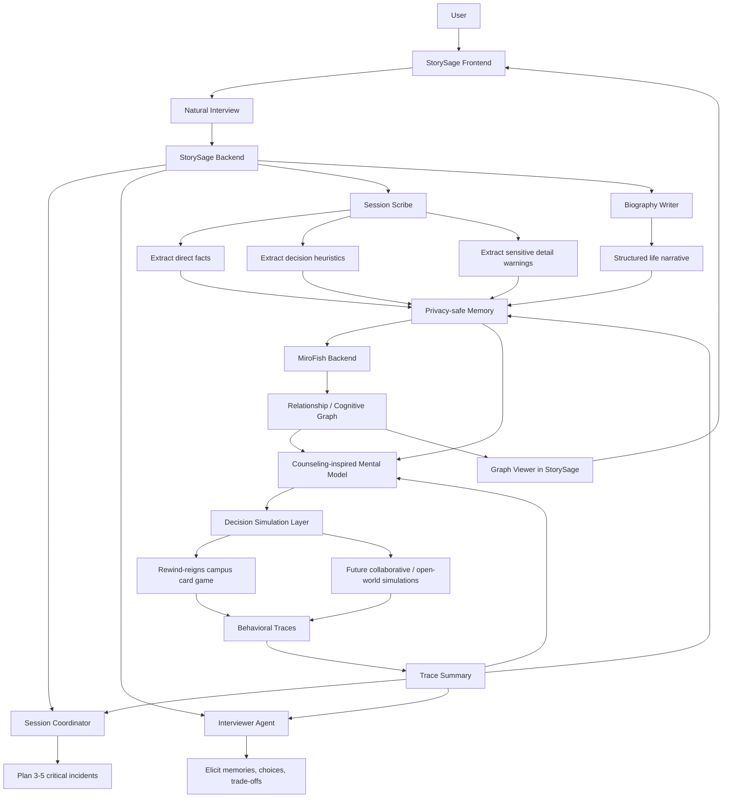

# RewindAI Technical Documentation

## 1. Product Definition

RewindAI is a personalized social decision simulation system. Its goal is not to provide generic advice, but to construct a user-specific mental model from natural autobiographical dialogue, relationship graph extraction, and behavioral traces, then use that model to support downstream decision reflection and simulation.

This direction follows the abstract in `D:/Downloads/RewindAI.pdf`:

- Personalized advisors should model lived experience, relationships, and decision tendencies, not only recent chat history.
- StorySage-style autobiographical dialogue is the grounding layer.
- Relationship graph extraction adds people, groups, institutions, obligations, conflict, trust, closeness, and influence.
- A counseling-inspired formulation agent summarizes how the user differs from a generic participant in values, emotional triggers, interpersonal obligations, and decision policies.
- Downstream simulations can include Reigns-like decision cards, Overcooked-like collaboration, Minecraft-like worlds, or real-world scenario rehearsal.

The current workspace is a multi-project prototype for this architecture.

## 2. Current Project Map

```text
D:/Projects/miro.ai - 副本/
  StorySage/             Natural interview, memory, biography, API backend
  StorySage_Frontend/    Main user-facing frontend and RewindAI cockpit
  MiroFish/              Backend graph construction and simulation substrate
  Rewind-reigns/         Reigns-like campus decision game test harness
  RUN_LOGIC.md           Minimal runtime guide
```

The target product rule remains:

- `StorySage_Frontend` is the single main frontend.
- `StorySage` is the main application backend for users, auth, chat, memories, and biography.
- `MiroFish` is backend-only in the integrated product flow.
- `Rewind-reigns` is a downstream decision-simulation test module, not the main frontend yet.

## 3. System Architecture



## 4. Subsystem Responsibilities

### StorySage Frontend

The frontend should present the product as a natural grounding and simulation pipeline:

- Start or continue a natural interview.
- View and edit the generated autobiography.
- Trigger graph generation.
- Open the current user graph.
- Later, launch decision simulations such as Rewind-reigns from the same user context.
- Keep login, cockpit, natural interview, and autobiography pages in one refreshed green StorySage visual system so the product feels like a single reflective grounding experience rather than stitched-together demos.

It should avoid making the product feel like a structured questionnaire system. The central user interaction is natural language storytelling and reflection.

### StorySage Backend

StorySage remains the source of truth for user identity and autobiographical grounding.

Current operational endpoint:

- `GET /health`: lightweight backend health check for launchers and runtime verification.

Main roles:

- User auth and session ownership.
- Data integrity for interview history, including per-user uniqueness of session sequence IDs so `/sessions/{seq_id}/messages` resolves to a single owned session.
- Public chat API error handling that preserves intentional 4xx responses while using stable, credential-safe 500 errors for unexpected failures.
- Public voice API error handling that preserves intentional 400 responses while using stable, credential-safe 500 errors for OpenAI speech/transcription provider failures.
- Public auth, biography, and simulation-profile API error handling that keeps user-correctable 4xx responses but avoids exposing database/provider exceptions, credential-like text, or local paths in unexpected 500 responses.
- Public simulation trace contract validation that preserves useful 400 responses and compatibility warnings while redacting credential-like text and local paths from protocol, version, and module fields.
- Public graph and formulation API not-found handling that preserves 404 status codes while avoiding raw `FileNotFoundError` text, credential-like strings, or local filesystem paths in browser-facing responses.
- Conversation routing through `/messages`.
- Session coordination around critical incidents and high-stakes scenarios.
- Memory extraction through Session Scribe.
- Biography generation and editing.
- Triggering graph rebuilds after biography/session updates.

Recommended agent behavior:

- The Session Coordinator chooses a compact set of critical incidents or high-stakes scenarios.
- The Session Coordinator may use downstream simulation traces as tentative hints when choosing the next 3-5 incidents to explore.
- The Interviewer keeps the experience conversational and asks one concrete question at a time.
- The Interviewer may ask one gentle trace-informed reflection at a time, but should ask the user to confirm whether the pattern feels real.
- The Session Scribe records both direct retrieval facts and decision-relevant patterns.
- The biography layer preserves lived experience while avoiding unnecessary sensitive detail exposure.
- Simulation traces do not directly update the user portrait or biography unless the user confirms them in natural conversation.

### MiroFish Backend

MiroFish is the graph and simulation substrate for the integrated product.

Main roles:

- Receive autobiography and memory text from StorySage.
- Build a person-centric graph from entities, relationships, decision episodes, and influence edges.
- Return graph status and graph data to StorySage.
- Support future simulation backends without requiring users to open MiroFish frontend.

StorySage sends MiroFish a privacy-safe graph source payload with an explicit evidence boundary manifest. The latest biography is marked `confirmed_autobiographical_grounding`; Rewind decision traces are marked `tentative_simulation_evidence`. MiroFish may use tentative traces as hypotheses for graph context or future questions, but they should not be treated as confirmed biography or user identity without confirmation in StorySage conversation.
The current graph data API and the StorySage graph viewer expose this `source_manifest` so the graph's evidence boundary is visible after rebuild.
The graph viewer renders manifest values as text-only chips rather than HTML.

Current StorySage graph API:

- `POST /graph/public/rebuild`
- `GET /graph/public/state`
- `GET /graph/public/current/data`
- `GET /graph/public/view-token`: returns a short-lived scoped token for opening the graph viewer without exposing the long-lived login token in the URL.
- `GET /graph/ui`
  - StorySage_Frontend opens this viewer with `view_token` only; the backend infers the user from the scoped token and rejects mismatched user requests.

`GET /graph/public/current/data` returns `source_manifest` when the graph was built by the RewindAI graph sync path.

Current StorySage simulation API:

- `GET /simulation/profile`: exports the current user's privacy-safe Rewind grounding profile from the latest biography.
- `GET /simulation/traces/summary`: returns visible behavioral trace grounding status for the current user.
- `POST /simulation/traces`: stores Rewind run records as downstream behavioral traces.

The simulation profile now includes `grounding.graph_constraints`, a compact summary of MiroFish graph availability, relationship focus labels, relation types, and scenario prompts. It does not export the raw graph.
It also includes `rewindai_contract`, currently `protocol=rewindai.grounding` and `version=1.0`, plus `trace_ingest.accepts` for the return path. Rewind-reigns sends `contract.protocol=rewindai.trace` when posting traces back to StorySage. StorySage accepts older trace payloads without contract metadata for backward compatibility, but validates the protocol when the metadata is present.
The profile also includes `grounding.card_generation_guidance`, a structured simulation-design object with graph-pressure card quota, relationship roles, relationship tensions, decision-policy incidents, pressure mechanics, target meters, risk distribution, trace summary, and safety rules. Rewind-reigns consumes this object directly when present and falls back to compact text parsing for older payloads.

Current StorySage formulation API:

- `GET /formulation/current`: reads the current RewindAI mental model draft, building one if needed.
- `POST /formulation/rebuild`: rebuilds the draft from latest biography, graph state/data, and behavioral traces.

The formulation layer is deterministic for now. It does not call an external LLM and should be treated as a draft synthesis, not a diagnosis.
When new evidence arrives, the current formulation is marked `stale` instead of being rebuilt automatically. Current stale triggers include biography edits, completed MiroFish graph rebuilds, and new Rewind traces. The StorySage cockpit should prompt the user to rebuild the model when stale.
Stale marking is best-effort: failures are surfaced as warnings where possible, but they do not block biography edits, graph rebuild completion, or trace ingestion.

Current MiroFish graph API used by StorySage:

- `GET /health`
- `POST /api/graph/ontology/generate`
- `POST /api/graph/build`
- `GET /api/graph/task/{task_id}`
- `GET /api/graph/data/{graph_id}`

MiroFish backend API responses are treated as backend-only integration contracts, not user-facing debugging dumps. Internal graph, simulation, and report route failures return stable `success: false` JSON with bounded, credential-safe error summaries. Public responses and task failure states omit Python tracebacks, redact provider-key-shaped strings, and redact full local filesystem paths. Server logs use the same public-safe redaction filter so StorySage-originated biography or provider context is not accidentally copied into console/file logs.

### Rewind-reigns

`Rewind-reigns` is the first downstream controlled social decision environment. It is currently a standalone testing module and should be treated as a simulation harness.

Current capabilities:

- Reigns-inspired campus decision-card gameplay.
- 1000+ English/Chinese campus scenario cards.
- 20 campus character portraits.
- Randomized starts, dependency events, delayed follow-ups, score changes, and run records.
- Four resources: GPA, Friends, Energy, Budget.
- Scenario Studio for generating 20-30 custom cards from user-provided background, scenario description, provider, model, and API key.
- Providers supported by the local module: OpenAI, Gemini, Anthropic, DeepSeek.
- Serverless-safe session revival for Vercel-style API routing. Revival sanitizes returned frontend state, keeps only game/runtime contract fields, and redacts credential-like text in restored custom cards/history, preventing API keys, full grounding context, generation guidance, or non-contract snapshot fields from re-entering session responses or trace records.

Current local APIs:

- `GET /api/health`
- `GET /api/cards`
- `POST /api/custom-cards/generate`
- `POST /api/sessions`
- `GET /api/sessions/:sessionId`
- `POST /api/sessions/:sessionId/decisions`
- `GET /api/sessions/:sessionId/analytics`

In the full RewindAI architecture, this module should consume StorySage/MiroFish user grounding instead of asking for a separate background manually.

Current bridge:

- StorySage_Frontend calls `GET /simulation/profile`.
- StorySage_Frontend opens Rewind-reigns with `?grounding=<base64-json>` using UTF-8-safe base64 encoding so Chinese autobiographical context and bilingual scenarios survive the URL handoff.
- Rewind-reigns decodes the grounding payload, pre-fills Scenario Studio background/scenario fields, and prompts the user to add a provider API key before generating a personalized card pack. Provider API keys are used only for the generation request; generated run records exclude them, and provider errors redact both raw and URL-encoded key variants before returning messages to the frontend.
- When StorySage grounding is present, Scenario Studio also shows a StorySage-proposed simulation pack blueprint before generation. The blueprint summarizes graph-pressure quotas, relationship roles/tensions, target meters, risk mix, decision incidents, pressure mechanics, and trace-informed context from the privacy-safe guidance, so the workbench feels system-proposed rather than manually questionnaire-driven.
- Scenario Studio can draft a deterministic 20-card starter pack directly from the StorySage blueprint without a provider API key. This starter pack is intentionally labeled as local/template-based; it gives users an immediate playable simulation path for testing grounding and trace return, while the provider-backed `Generate Pack` path remains available for richer custom generation.
- Rewind-reigns removes the `grounding` query parameter from the browser URL immediately after decoding it, so short-lived trace tokens and compact grounding payloads are not left in the address bar after handoff.
- The grounding payload carries a small RewindAI contract block so Rewind-reigns can preserve source module, target module, protocol version, and privacy level in its run snapshot.
- Rewind scenario generation receives graph-derived relationship constraints when a MiroFish graph is available.
- Rewind-reigns converts graph constraints, behavioral trace summaries, and mental model drafts into compact generation guidance. New payloads pass structured `card_generation_guidance`; older payloads still work through `groundingContext` text parsing. The generation backend derives a `Grounding-informed card distribution` brief, including relationship-pressure quotas, decision-policy incidents, pressure mechanics, risk variety, and relevant meter coverage. The raw graph and full biography are not stored in the run snapshot.
- Rewind-reigns local records keep only grounding source metadata in `initialSnapshot.groundingSource`; full StorySage summaries, graph constraints, and privacy policies are used for generation but are not persisted in local gameplay records.
- Rewind-reigns local records are sanitized both when old records are read from `localStorage` and when new run records are written, removing non-contract sensitive fields and field-name variants such as provider keys, trace tokens, full grounding context, and generation guidance while redacting credential-like text in historical choices/outcomes. The server-side session revival path applies the same credential-like text redaction to grounding-source metadata.
- After the first run, Clone Advisor must collect one user-authored reflection about a choice the user considered but did not take. It then stores a `reflection` object on the run record with `evidence_boundary=tentative_counterfactual_rehearsal`, `simulation_role=clone_imitates_user_for_unchosen_choice`, and a `reflection_to_replay_loop`, including the unchosen option, the clone-as-user simulated rehearsal, and one second-run inspiration rule.
- The clone is imitation-first: it should role-play the grounded user trying the unchosen path before offering advice. The simulated outcome is inspiration for assisted replay, not a claim about what the real user would definitely do. The human remains in control of round two and can accept, reject, or adapt the simulated result.
- Records must surface both `Reflection-to-replay loop` and `Clone simulation role` so the demo makes clear that the AI is simulating a path the person says they did not take, then using the imagined result to inspire the real person's next decision.
- The OdysSim influence is deliberately narrow: use behavioral-simulation framing to avoid a generic helpful-assistant voice. In RewindAI this becomes a local protocol, not model training: SOUL/failure-mode signals describe where the first run broke down, the clone imitates the user's grounded style on one unchosen path, then the imagined result becomes a concrete second-run experiment.
- The second run must remain auditable. Records should show the first-run and second-run reports side by side, including high-friction cards, card domains/categories, failure modes, simulated meter shift, and the clone counterfactual review that inspired the replay.
- Rewind-reigns posts run records back to `POST /simulation/traces` using the short-lived trace token from the grounding payload and a `rewindai.trace` contract block.

## 5. Data Flow

### Current Integrated Flow

```text
User
  -> StorySage_Frontend
  -> StorySage backend
       -> natural interview
       -> memory extraction
       -> biography update
       -> graph sync service
       -> MiroFish backend
            -> ontology generation
            -> graph build
            -> graph data
       -> StorySage graph UI
```

### Target RewindAI Flow

```text
Natural interview
  -> privacy-safe memories
  -> autobiography
  -> mark current formulation stale after biography update
  -> relationship and decision graph
  -> mark current formulation stale after graph rebuild
  -> counseling-inspired mental model
  -> decision simulation
  -> behavioral traces
  -> updated memory / graph context
```

Current trace return path:

```text
Rewind-reigns record
  -> POST /simulation/traces
  -> StorySage data/<user>/simulation_traces/
  -> mark current formulation stale
  -> behavioral trace summary
  -> SessionCoordinator natural agenda planning
  -> Interviewer trace-informed follow-up questions
  -> RewindAI mental model formulation
  -> StorySage simulation profile
  -> StorySage Frontend grounding status
  -> MiroFish graph rebuild payload
```

The live HTTP bridge is covered by `VERIFY_REWINDAI_HTTP_LOOP.ps1`. It checks StorySage `/health` auth status, registers and logs in one temporary StorySage smoke user, creates that user's fixture biography, rebuilds formulation, exports a privacy-safe simulation profile, opens the scoped graph viewer over HTTP, creates a grounded Rewind session, submits one Rewind decision, posts the resulting trace back to StorySage, verifies trace summary availability, and confirms the current formulation is marked stale.
The browser-facing login/register path is covered by `VERIFY_REWINDAI_BROWSER.ps1` when the local StorySage frontend/backend are already running. It drives a real headless browser through failed login, registration, landing on the RewindAI cockpit, opening the graph viewer from the cockpit `Show graph` button when `-RewindWebUrl` is supplied, opening Rewind from the cockpit `Launch Rewind` button when `-RewindWebUrl` is supplied, opening the biography greenhouse UI at `/biography` through the cockpit `Biography` button, and opening the StorySage interview UI at `/user_chat` without sending a live LLM message. The Show graph pass verifies the scoped `view_token` URL, evidence boundary manifest, and raw-address redaction. The Launch Rewind pass prepares a local StorySage fixture for the same browser smoke user, verifies the Rewind page receives StorySage grounding, pre-fills Scenario Studio, and clears `grounding=` from the address bar. The same browser smoke also opens Rewind-reigns with a synthetic StorySage grounding payload, verifies Scenario Studio prefill, and proves the `grounding` query parameter is removed from the address bar while unrelated query parameters remain. The script reuses the Playwright dependency from `Rewind-reigns`; runtime/live verification can pass `-SkipBrowser` when browser dependencies are unavailable.
For an already-running local demo stack, `VERIFY_REWINDAI_LIVE.ps1` composes health checks, browser login/register and Rewind URL-handoff verification, and the HTTP grounding-to-trace loop without starting or stopping services.

The system should support two grounding modes:

- Direct retrieval: use a remembered fact or episode when the user has explicitly discussed it.
- Graph reasoning: infer likely decision pressure from relationships, obligations, values, conflicts, and prior choices.
- Formulation synthesis: summarize how current evidence may differ from a generic participant, while marking gaps and confidence.

The StorySage home cockpit should expose whether behavioral traces are available, how many Rewind runs have synced, how many decisions are feeding the current grounding state, and whether those traces carried aggregated privacy labels.
It should also expose the current mental model draft status, confidence, and first unresolved gap.

## 6. Privacy and Sensitive Content

RewindAI should preserve decision-relevant meaning while reducing unnecessary identifiability.

Current baseline implementation:

- `api.services.privacy.sanitize_privacy_safe_text` removes or generalizes obvious emails, phone numbers, API keys/provider tokens, exact street addresses, and exact age phrasing.
- `api.services.privacy.classify_sensitive_content` adds count-only sensitive-content labels for direct contact details, credential-like secrets, exact addresses, exact ages, and named authority/private-person references. It does not store matched source text.
- StorySage simulation profiles use this sanitizer before exporting Rewind grounding.
- StorySage flattens structured biography section trees into natural prose before profile, formulation, and graph privacy handling, so edited autobiography sections are covered alongside legacy plain-text biographies.
- StorySage simulation profiles include `grounding.privacy_signals` so downstream modules know whether the source contained sensitive material without receiving the raw sensitive text.
- RewindAI mental model formulations use this sanitizer before writing grounding summaries.
- RewindAI mental model formulations include privacy-signal evidence and backfill it for older saved drafts when read.
- MiroFish graph rebuild payloads now use this sanitizer before sending biography text for ontology/graph construction.
- MiroFish graph rebuild payloads include an evidence manifest that separates confirmed autobiography from tentative simulation traces.
- MiroFish graph rebuild manifests include the same count-only privacy-signal summary.
- Rewind trace ingestion sanitizes returned simulation records before writing them under `simulation_traces/`, stores count-only trace `privacy_signals` metadata, and carries aggregated trace privacy signals into trace summaries and graph-source payloads.
- If a Rewind run includes a clone counterfactual reflection, StorySage keeps it as tentative rehearsal evidence in the trace summary. It can inform later questions, formulation, and graph context, but it must not be promoted into confirmed autobiography without user confirmation.
- Rewind trace indexes store relative trace file references instead of absolute local filesystem paths; legacy absolute-path indexes are read only when the path still resolves inside the current user's trace directory.
- Session Scribe memory/session-note prompts now include privacy-safe memory rules so direct contact details, exact addresses, and unnecessary exact identifiers are generalized before long-term storage.
- Session Scribe tool calls now enforce the same rule deterministically: stored memories and session notes are sanitized at write time and keep count-only `privacy_signals` metadata without matched source text.
- Biography Writer prompts now include privacy-safe writing rules so generated biography sections avoid preserving unnecessary identifying details.

Recommended policy:

- Exact addresses become generalized places.
- Exact ages can become age bands when the exact number is not important.
- Private names can become relationship roles.
- School, employer, or location names can be generalized when they are not necessary for the decision model.
- Sensitive details should be retained only when they materially affect the user's relationships, obligations, values, or decision tendencies.

Example substitutions:

- `I live on Green Street` -> `I live on a specific local street`
- `I am 20 years old` -> `I am a young adult`
- `My advisor Dr. Smith pressured me` -> `A trusted academic authority pressured me`

This baseline is not full anonymization. It should be strengthened over time with sensitive-content labels inside stored memory records, entity-role substitution for private names, and a dedicated sensitive-content review agent if prompt-only protection is not strong enough.

## 7. Scenario Studio Positioning

Scenario Studio is useful as a product workbench, but in the full RewindAI system it should evolve from "user manually describes a background" to "system proposes a simulation pack from the user's grounded model."

Near-term integration path:

1. Keep Rewind-reigns standalone for testing card mechanics.
2. Export a privacy-safe user profile from StorySage through `GET /simulation/profile`.
3. Pass that profile plus compact graph-derived relationship constraints into Scenario Studio.
4. Draft a local starter pack immediately from the StorySage blueprint, or generate richer personalized decision cards with a user-supplied provider key.
5. Save decisions and trajectories as behavioral traces.
6. Post traces back to StorySage through `POST /simulation/traces`.
7. Summarize traces as behavioral evidence.
8. Feed trace summaries back to StorySage/MiroFish as additional grounding.

## 8. Runtime Guide

### Minimal Environment

The local demo keeps a development fallback so old smoke tests and one-machine demos do not break. For any shared or deployed environment, configure `STORYSAGE_JWT_SECRET` with a long random value. StorySage uses it to sign login tokens, scoped graph-view tokens, and Rewind trace-ingest tokens.
`GET /health` exposes non-secret JWT configuration status so operators can see whether a development fallback is still active; it never returns the secret value itself.
For Vertex-backed Gemini/Claude models, `GCP_CREDENTIALS` may be an absolute path or a path relative to either the `StorySage/` project root or the workspace root.
`GET /health` also exposes non-secret LLM provider setup status, including model name, provider family, required variable presence, and GCP credential resolution, without returning API keys or full credential paths.
AWS S3 is optional for text-to-speech in local demos. When `AWS_BUCKET_NAME` is not configured, StorySage stores generated TTS audio under `DATA_DIR/tts` and returns a short-lived scoped local playback URL rather than requiring S3 presigned URLs.

### StorySage Backend

```powershell
cd "<PROJECT_ROOT>\StorySage"
.\.venv\Scripts\python.exe src/main.py --mode server --port 8000
```

### StorySage Frontend

```powershell
cd "<PROJECT_ROOT>\StorySage_Frontend"
npm run dev -- --host 127.0.0.1 --port 5173
```

### MiroFish Backend

```powershell
cd "<PROJECT_ROOT>\MiroFish\backend"
.\.venv\Scripts\python.exe run.py
```

### Rewind-reigns Test Harness

```powershell
cd "<PROJECT_ROOT>\Rewind-reigns"
npm run dev
```

Default ports:

- StorySage Frontend: `http://127.0.0.1:5173`
- StorySage Backend: `http://127.0.0.1:8000`
- MiroFish Backend: `http://127.0.0.1:5001`
- Rewind-reigns web: `http://127.0.0.1:5174`
- Rewind-reigns API: `http://127.0.0.1:3001`

Rewind-reigns is pinned to `5174` so StorySage_Frontend can keep `5173` and its `Launch Rewind` button can open the expected local target.
The integrated launcher starts `StorySage_Frontend` as the single product frontend and never starts `MiroFish/frontend`; MiroFish participates only through its backend service on `5001`.
The local launcher checks required ports before starting services so port conflicts fail early with the owning process details.
If startup reaches the health-check phase and one service does not become ready, the launcher calls the stop script to clean up the partially started stack while preserving the root-level log files.
The stop script also performs a managed-port cleanup pass, which catches workspace-owned or known local service child processes that can outlive the original PowerShell/npm wrapper on Windows.

## 9. Implementation Priorities

### Phase 1: Stabilize the Current Closed Loop

- Login.
- Natural chat.
- Biography update.
- Graph rebuild.
- Graph viewer from StorySage.

### Phase 2: Align Product Language With RewindAI

- Replace old evaluation-heavy language with natural grounding, relationship graph, mental model, and decision simulation language.
- Keep UI focused on the StorySage entry point.
- Present Rewind-reigns as a simulation testbed, not as a second main product.

### Phase 3: Add Rewind-reigns as a Downstream Module

- Use the current `GET /simulation/profile` export as the first StorySage grounding bridge.
- Generate a card pack from the profile plus compact graph-derived constraints when graph data is available.
- Store Rewind decisions as behavioral traces through `POST /simulation/traces`.
- Include trace summaries in `GET /simulation/profile` and MiroFish graph rebuild payloads.

### Phase 4: Add Privacy Hardening

- Add sensitive-content labels in Session Scribe outputs. First deterministic count-only labels are implemented for stored memories, session notes, StorySage profiles, mental model evidence, and MiroFish graph payload manifests.
- Add privacy-safe memory and biography writing instructions. First prompt guard is implemented for Session Scribe and Biography Writer.
- Strengthen the current deterministic sanitizer with entity-role substitution and sensitive content review. First pass is implemented for street-only place references, titled private names, and review-required metadata.

## 10. Acceptance Criteria

The integrated product is considered healthy when:

See `REWINDAI_ACCEPTANCE_MATRIX.md` for the current evidence map from each criterion to its verification script.

- A user can complete a StorySage interview and update biography.
- Graph rebuild succeeds through StorySage without opening MiroFish frontend.
- StorySage graph viewer opens the current user's graph.
- Rewind-reigns can run independently as a simulation test harness.
- `VERIFY_REWINDAI.ps1` passes from the workspace root.
- `VERIFY_REWINDAI_SMOOTH.ps1` passes before a local demo, proving code-level checks, the running demo stack, isolated cold-start launch/cleanup, port status, and recent log smoothness.
- `VERIFY_REWINDAI_RUNTIME.ps1` passes on default ports when they are free, or on custom isolated ports while the default demo is already running, including browser login/register verification by default and the live HTTP grounding-to-trace loop when Rewind is enabled.
- `VERIFY_REWINDAI_LIVE.ps1` passes against an already-running local demo stack without starting or stopping services.
- `VERIFY_REWINDAI_BROWSER.ps1` passes against a running local StorySage frontend/backend, proving the browser login/register path lands on the RewindAI cockpit, opens the graph viewer from the cockpit `Show graph` button, opens Rewind from the cockpit `Launch Rewind` button, opens the biography greenhouse UI from the cockpit `Biography` button, and opens the StorySage interview UI. When `-RewindWebUrl` is supplied, it also proves graph evidence-boundary rendering, Rewind grounding URL cleanup, and Scenario Studio prefill.
- `StorySage/scripts/smoke_rewindai_backend.py` passes locally, covering the privacy/profile/Session Coordinator agenda rules/session-end biography handoff/StorySage-triggered graph rebuild/formulation/trace backend loop without external services.
- `MiroFish/backend/scripts/smoke_contract.py` passes locally, covering the Flask app factory, `/health`, and StorySage-required graph route contracts without external LLM/Zep calls.
- `Rewind-reigns` `npm run smoke:session` passes locally, proving the downstream simulation harness can start its API, create a session, submit a decision, and expose analytics independently.
- `Rewind-reigns` `npm run smoke:grounding` passes locally, proving StorySage graph/model/trace guidance reaches custom card generation prompts without external providers.
- `Rewind-reigns` `npm run smoke:bridge` passes locally, proving the Rewind frontend still reads StorySage grounding payloads and preserves the trace return path.
- Documentation clearly explains how Rewind-reigns fits into the larger RewindAI architecture.
- No technical document describes the product as primarily questionnaire-based or normalized-accuracy-based.
